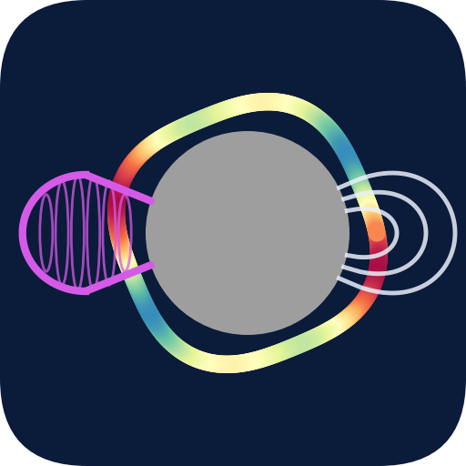
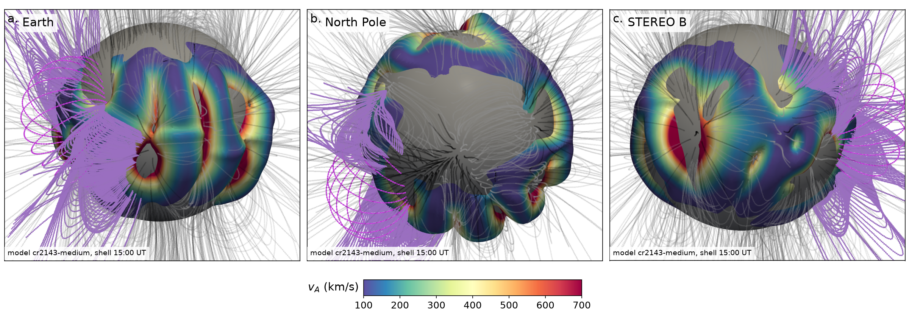
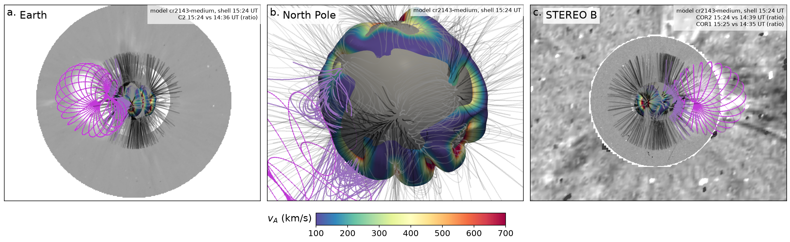
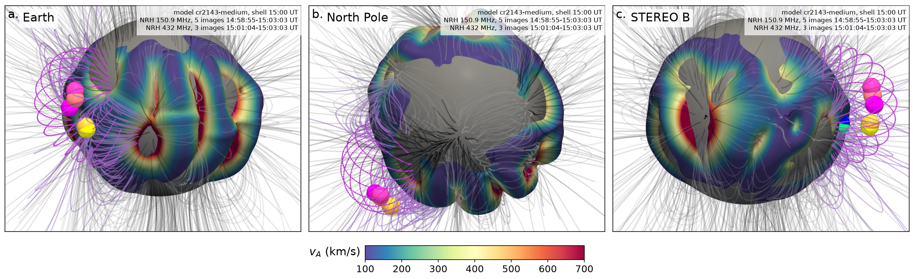

<p align="center"></p>

# corona3d

[](https://doi.org/10.5281/zenodo.23801369)

> **Public** (pre-release). corona3d is ready for use and for testing, although its results can still change between versions, and problems, wrong results, and suggestions are welcome on the [issue tracker](https://github.com/jovian-explorer/corona3d/issues/new/choose). To cite corona3d, please use [CITATION.cff](CITATION.cff); the Zenodo concept DOI [10.5281/zenodo.23801369](https://doi.org/10.5281/zenodo.23801369) always resolves to the latest version, and version 0.2.0 has [10.5281/zenodo.23801370](https://doi.org/10.5281/zenodo.23801370).

## Purpose

Coronal mass ejections (CMEs) drive shocks through a corona whose density, magnetic field, and Alfvén speed vary strongly with height, latitude, and longitude. The radio bursts that these shocks excite, such as type II bursts and their herringbones, are emitted where the shock meets plasma of a particular density and field geometry. Whether a shock becomes super-Alfvénic, and whether it accelerates electrons along closed streamer loops or along open field, therefore depends on the three-dimensional structure of the corona at the moment the CME passes, which no single image can show. Global models of the corona, coronagraphs on spacecraft at different positions, and imaging radio arrays together contain the information needed to recover this structure, although each of them is distributed in its own format, coordinate frame, and archive. Reconstructions that combine a magnetohydrodynamic (MHD) model of the corona, a graduated cylindrical shell (GCS) of the CME, and radio-source positions have therefore been built by hand for single events, as for the CME of 2013 October 25 by Morosan et al. ([2022](https://doi.org/10.1051/0004-6361/202244432)), and their inputs and steps are rarely published in a form that another group can repeat. The relation between CME shocks, the coronal field, and the radio sources therefore remains poorly quantified for most events.

corona3d is a Python package that we developed to make this three-dimensional reconstruction of the corona, the CME, and the radio sources a repeatable measurement for any event, from its time and flare position, using public data and physical models only. The coronal model of Predictive Science Inc. (PSI) is rendered in three dimensions, the GCS shell of the CME is fitted to the coronagraph images, the white-light images of the Solar and Heliospheric Observatory (SOHO) and of the Solar Terrestrial Relations Observatory (STEREO) are placed in the plane of the sky of their spacecraft, and the radio sources measured in images of the Nançay Radioheliograph (NRH; Kerdraon & Delouis [1997](https://doi.org/10.1007/BFb0106458)) and of the Owens Valley Radio Observatory Long Wavelength Array (OVRO-LWA; Chhabra et al. [2021](https://doi.org/10.3847/1538-4357/abc94b)) are deprojected to their emission heights. Every layer can be switched on or off, every viewpoint can be chosen, every layer can be exported as arrays or tables, and every step is recorded with its inputs, so that a reconstruction can be repeated and checked by others. The CME of 2013 October 25 is the validation case of corona3d, in which its result is compared with the earlier reconstruction of Morosan et al. (2022), and the CME and type II burst of 2024 May 9 is a new application.

## What is new in corona3d

Compared with the earlier hand-built reconstruction of Morosan et al. (2022), corona3d adds several capabilities that make the result objective and repeatable. Its own field-line tracer integrates the unit field vector with a fourth-order Runge-Kutta scheme through the whole model, and on the run of 2013 October 25 its lines are tangent to the field (median |cos(line, B)| of 1.000, against 0.83 for the tracer of psipy that we tested), while every line is classed as open, closed, or undetermined. The streamer loops that the CME meets are selected without free parameters as the closed lines through the CME shell, and the GCS shell is fitted automatically to the coronagraph images, with the intersection over union (IoU) in each instrument as its objective and its measure of quality, with guards against degenerate shells and unconstrained directions, and with an apex height at the time of the burst that is extrapolated from the height-time profile of the front together with its uncertainty. Moreover, the coronagraph images are placed inside the three-dimensional reconstruction on one common scale, the radio sources are measured directly in the images of two radioheliographs and drawn as blobs or as contours at chosen levels, any viewpoint can be chosen, and every layer can be exported with its provenance. Finally, one command reconstructs any event from its time and flare position and writes a report that separates what was measured from what was assumed, and 150 offline tests check each step. Section 11 of the [user guide](docs/USER_GUIDE.md) compares the two reconstructions item by item.

## What corona3d does

The reconstruction is built from layers, each of which is computed from its own data and placed in one common Heliographic Carrington frame in solar radii (R⊙), so that the model, the shell, the images, and the radio sources can be compared directly.

| Element | What corona3d computes | Data and tools |
|---|---|---|
| Coronal model | the surface of constant electron density at the plasma level of a chosen frequency, coloured by the Alfvén speed, the open and closed field lines traced through the whole model, and the closed lines through the CME shell, which are the streamer loops that the CME meets | the PSI MAS/MAST thermodynamic MHD run of the Carrington rotation of the event, drawn with PyVista and the Visualization Toolkit (VTK) |
| CME shell | the GCS shell fitted to the CME envelopes in the coronagraph images, with its apex height extrapolated to the time of the reconstruction from the height-time profile of the front, and the quality of the fit stated with the intersection over union (IoU) in each instrument | PyThea, with the images of the Large Angle and Spectrometric Coronagraph (LASCO) C2 and of COR1 and COR2 on STEREO-A or STEREO-B |
| White-light images | the brightness ratio, or difference, of each frame against the first frame of the download window, drawn on the plane through Sun centre perpendicular to the line of sight of its spacecraft | LASCO C2 and STEREO COR1 and COR2, level 0.5, through the Virtual Solar Observatory |
| Radio sources | the centroids of the burst sources as chains of coloured blobs, and their contours at chosen fractions of the peak, placed at the heights of the four-fold Newkirk model for emission at the second harmonic | NRH images at 150 to 450 MHz, OVRO-LWA images at 32 to 87 MHz from 2024 April onward, and positions supplied by the user |
| Viewpoints | orthographic panels from Earth, from the STEREO spacecraft, from above the solar north pole, or from any Carrington longitude and latitude | observer positions from the ephemerides of the Jet Propulsion Laboratory (JPL Horizons) through SunPy |
| Workflow | one `config.json` per event, the commands `new`, `fetch`, `radio-interval`, `gcs`, `render`, `export`, and `event`, and a list of the radio bursts of a day from the event reports of the Space Weather Prediction Center (SWPC) of the National Oceanic and Atmospheric Administration (NOAA) | the public archives above |
| Output | figures, the layers as `npz`, `csv`, or VTK files with `metadata.json`, and `event_report.md`, which separates what was measured from what was assumed | |

Since every element is a key of the configuration, the same commands apply to an event observed by STEREO-B before 2014 October or by STEREO-A afterwards, with NRH or OVRO-LWA images, and with a model run of any Carrington rotation in the PSI archive.

## Install

corona3d needs Python 3.12 or newer, because PyThea 1.3, which builds the GCS shell, requires it, and it runs on Windows, macOS, and Linux. Once corona3d is released on PyPI, one command installs it with every optional part:

```
pip install "corona3d[all]"
```

Until then, pip installs it directly from the public repository:

```
pip install "corona3d[all] @ git+https://github.com/jovian-explorer/corona3d.git"
```

The plain package is the light core (downloads, event set-up, radio interval, `corona3d doctor`). The extras `render` (PyVista and PyThea, for the figures), `gcs` (PyThea and scikit-image, for the shell fit), and `radio` (h5py, for OVRO-LWA) add the heavy packages, `all` adds the three, and a command that needs a missing one names the extra to install. `corona3d --version` prints the version, and `corona3d doctor` reports the extras, the working directory (by default the platform cache directory, changed with `--home` or `CORONA3D_HOME`), and which archives answer. Since the newest pyhdf wheel for macOS requires macOS 26 and Homebrew no longer provides the HDF4 library, older Macs install with `pip install --prefer-binary`, which takes the previous pyhdf wheel, and `conda install -c conda-forge pyhdf` is an alternative on any system. The user guide ([Section 1](docs/USER_GUIDE.md#1-install-and-start)) gives the details.

## Quick start: one command for any event

```
mkdir event_work
cd event_work
corona3d event --time 2024-05-09T17:32 --flare S14W28
```

The command writes the configuration of the event from its time and the flare position (14° south and 28° west of the disc centre), downloads the PSI MAS/MAST run and the white-light images, and, from 2024 April onward, the OVRO-LWA images, chooses the interval of the radio burst from the images, fits the GCS shell to the coronagraph images, draws the figures, and writes `event_report.md`. The report separates what was measured from what was assumed, lists the missing data, and gives the quality of the fit. When the free fit of the shell fails or is poor, the fit with the direction held at the flare site follows, and the report says so. The 2-D images of the NRH cannot be downloaded automatically (see the data sources below), and the report then names the manual step. The download takes a few minutes and the fit several more, whereas a figure takes about 40 s.

When only the date of an event is known, `corona3d event --time 2024-05-09 --flare S14W28` lists the type II and type III bursts of that day, and `--burst N` runs the event at the begin time of burst N, for example `--time 2024-05-09 --burst 4` for the type II burst of 17:32 UT. The same steps can also be run one at a time, which is useful when a step has to be checked or repeated with other options:

```
corona3d new --time 2024-05-09T17:32 --flare S14W28   # config.json of the event
corona3d fetch                                        # model run and white-light images
corona3d fetch --ovro-lwa                             # OVRO-LWA images of the radio interval
corona3d radio-interval                               # burst interval chosen from the radio images
corona3d gcs --flare 28 -14 --views c2,cor1a,cor2a    # GCS fit to the coronagraph images
corona3d render --radio                               # figures/corona3d.png with the radio sources
corona3d export --format vtk                          # the layers as files for ParaView
corona3d animate --start 2024-05-09T17:30 --end 2024-05-09T17:40 --step 60 --radio --gif --mp4
```

The figures are written to `figures/` together with the image of each panel (`view_a.png`, `view_b.png`, `view_c.png`). The options `--panel` and `--layout` of `render` and `animate` choose any views (Earth, solar north, STEREO, Solar Orbiter, or a Carrington direction) and draw them in one row, in one column, or as separate images, while `animate` writes a GIF and an MP4 of the reconstruction through a time interval (user guide, Section 4.1). Moreover, the [user guide](docs/USER_GUIDE.md) describes every command, option, and parameter, [docs/METHODS.md](docs/METHODS.md) derives how each element of the reconstruction is computed, [docs/LIMITATIONS.md](docs/LIMITATIONS.md) states where the results cannot be trusted, and [docs/MODEL_AUDIT.md](docs/MODEL_AUDIT.md) lists every method and number with its source and its test.

## Validation: the CME of 2013 October 25

The validation case of corona3d is the CME of 2013 October 25, which was launched from the eastern hemisphere at about 15:00 UT and observed from Earth and from STEREO-B, 142° apart, while the NRH recorded herringbones at 173 and 228 MHz. Morosan et al. (2022) published a hand-built three-dimensional reconstruction of this event (their Fig. 7), so that it is the one event for which the result of corona3d can be compared with an independent reconstruction. Its configuration is installed with the package, and the three panels are drawn from the same viewpoints as their Fig. 7, so that each layer can be compared panel by panel:

```
mkdir corona3d_work
cd corona3d_work
corona3d init                  # writes config.json of the validation event
corona3d fetch                 # model run and white-light images (about 130 MB)
corona3d render                # figures/corona3d.png
corona3d render --c2 --cor1 --cor2 --out figures/corona3d_wl.png
```

The command `corona3d render` draws this event as seen from Earth, from above the solar north pole, and from STEREO-B. The electron-density surface lies at 9 × 10⁷ cm⁻³, the level that Morosan et al. used for the 173 MHz harmonic emission, and is coloured by the Alfvén speed between 100 and 700 km s⁻¹. The open and closed field lines are traced from 4,500 footpoints, and the closed lines that pass through the CME shell, the loops of the streamer that the CME meets, are drawn in purple.

<p align="center"></p>

With `--c2 --cor1 --cor2`, the LASCO C2 image of 15:24 UT appears in the Earth view and the COR1 and COR2 images of STEREO-B appear in the STEREO-B view, each divided by the first image of the download window (14:35 to 14:39 UT). The shell is then drawn at 15:24 UT, the time of the images.

<p align="center"></p>

With `--radio` and the NRH images of the event copied into `data/nrh/`, the sources of the burst are added as coloured blobs (user guide, Section 5.7). The images available for the afternoon of that day are those at 150.9 and 432 MHz, and between 14:59 and 15:03 UT one image per minute gives five blobs at 150.9 MHz and three at 432 MHz, at 1.647 and 1.221 R⊙. These frequencies differ from the 173 and 228 MHz of Morosan et al. (2022), so that the radio layer agrees with their sources in kind but not in frequency.

<p align="center"></p>

Since the model run of Morosan et al. (2022) is no longer served and their CME shell and radio positions were not published, the comparison tests whether corona3d, working from public data alone, recovers the structures of their reconstruction. Among the public runs of the same Carrington rotation, the one whose density surface agrees best with the outline of theirs was chosen, the GCS shell was fitted by corona3d from the public coronagraph images, and the radio sources are measured from the NRH images that can be obtained today. Section 11 of the [user guide](docs/USER_GUIDE.md) lists what agrees, what differs, and what corona3d adds.

## Application: the CME and type II burst of 2024 May 9

The CME of 2024 May 9 followed an X1.1 flare at S14W28 in active region 13664, and its type II burst began at 17:32 UT. Since STEREO-B lost contact with Earth in 2014 October and LASCO C2 has no frame between 14:48 and 18:52 UT, this event tests the parts of corona3d that the validation case does not, namely STEREO-A, a data gap, and the OVRO-LWA images. The preset installs its configuration, with the PSI run `cr2284-high/hmi_mast_mas_std_0201`, the positions of Earth and STEREO-A, and the OVRO-LWA images at 34.1, 52.4, 70.8, and 84.6 MHz:

```
mkdir may2024_work
cd may2024_work
corona3d init --event 2024-05-09
corona3d fetch
corona3d fetch --ovro-lwa
corona3d render --radio --shell-on-top
```

The GCS shell of the preset was fitted to the COR1-A and COR2-A images at 17:55 UT with the direction held at the flare site, which gives an apex height of 3.722 R⊙ and an IoU of 0.878 in COR1-A. Earth and STEREO-A were separated by only about 12° in Carrington longitude, so that the two coronagraphs see the CME nearly from the same side and do not constrain its direction, and corona3d therefore ties the direction to the source region. Moreover, the coronagraph images show no rising front at 17:32 UT, and the apex height of 1.77 R⊙ at the time of the burst is assumed from a constant speed of about 985 km s⁻¹ after the flare onset at 17:23 UT, which the key `gcs_note` records. A shell this low lies partly inside the density surface, and `--shell-on-top` draws it, together with the radio sources, over the surface. The same event is reconstructed from its date alone with `corona3d event --time 2024-05-09 --flare S14W28 --burst 4`, and its `event_report.md` then states what was measured and what was assumed for this event, including the gap of LASCO C2 (user guide, Sections 9.1 and 9.5; [docs/LIMITATIONS.md](docs/LIMITATIONS.md), Sections 1 to 4).

## What is measured and what is assumed

| Element | Measured from data | Assumed or chosen |
|---|---|---|
| Corona before the CME | none | the steady-state PSI MAS/MAST run of the Carrington rotation; the density multiplied by 2 after Morosan et al. (2022) |
| Density surface and Alfvén speed | none | the density level `ne_level` (9 × 10⁷ cm⁻³); the Alfvén speed from the scaled density |
| Field lines and streamer loops | none | traced in the static model; loops selected as the closed lines through the shell |
| CME shell | six GCS parameters, fitted to the envelopes in LASCO C2 and COR1 or COR2 at the time of the images; apex height and speed extrapolated from the front | the direction held at the flare site when the free fit fails; an apex height given by hand; a constant speed between the frames |
| Coronagraph images | brightness ratio or difference against the first frame of the window | the image is placed in the plane of the sky through Sun centre |
| Radio sources | sky-plane centroids of the NRH or OVRO-LWA images above `min_tb` | the height of the four-fold Newkirk model at the second harmonic, on the side facing the observer; no correction for scattering |
| Observers | Carrington positions of Earth and STEREO from JPL Horizons through SunPy | none |

[docs/LIMITATIONS.md](docs/LIMITATIONS.md) describes the cases in which these inputs fail, namely halo CMEs, data gaps, a small separation between Earth and STEREO, assumed heights, the manual step for the NRH, and the resolution of the model.

## Data sources

The model run and the images are public, and `corona3d fetch` downloads them into the working directory.

| Data | Source and access | Used for |
|---|---|---|
| MAS/MAST thermodynamic MHD run (density and magnetic field; the mesh of the Alfvén-speed file), by default `cr2143-medium/hmi_mast_mas_std_0201` | [PSI model archive](https://www.predsci.com/data/runs/), public (Mikić et al. [1999](https://doi.org/10.1063/1.873474); Lionello et al. [2009](https://doi.org/10.1088/0004-637X/690/1/902); Mikić et al. [2018](https://doi.org/10.1038/s41550-018-0562-5)) | density surface, Alfvén speed, field lines |
| SOHO/LASCO C2 images, level 0.5 | Virtual Solar Observatory through SunPy, public (Brueckner et al. [1995](https://doi.org/10.1007/BF00733434)) | Earth-view overlay, GCS fit |
| STEREO-A or STEREO-B SECCHI COR1 polarisation triplets and COR2 total-brightness images, level 0.5 | Virtual Solar Observatory through SunPy, public (Howard et al. [2008](https://doi.org/10.1007/s11214-008-9341-4)); `--cor1a` adds STEREO-A COR1 | STEREO-view overlay, GCS fit |
| NRH 2-D images (Stokes I, about 10 s) | **On request only.** BASS2000 (Paris Observatory) holds only four snapshots per day at 164 and 327 MHz, movies, and visibility files; the 10 s images (`nrh2_*_i.fts`) are delivered by the Radio Solar Database at Nançay, [https://rsdb.obs-nancay.fr/](https://rsdb.obs-nancay.fr/), after a request there. The user copies the files into `data/nrh/`, and `corona3d fetch --nrh` reports which frequencies they cover | radio layer |
| OVRO-LWA spectral images (Stokes I, 10 s, 12 bands at 34 to 85 MHz), from 2024 April | [OVRO-LWA solar data](https://ovsa.njit.edu/docs/pages/ovro-lwa-solar-data-products/), public bucket on Amazon Web Services (CC BY 4.0); `corona3d fetch --ovro-lwa` | radio layer |
| Other radio-source positions (optional) | supplied by the user | radio layer |

SECCHI is the Sun Earth Connection Coronal and Heliospheric Investigation of STEREO. Work that uses these data should acknowledge the PSI model runs, the LASCO and SECCHI teams, the Nançay Radioheliograph, and OVRO-LWA with the references above, and all references are collected in [docs/refs.bib](docs/refs.bib).

## Using corona3d from Python

`corona3d.build(home, **layers)` returns the layers of a working directory as NumPy arrays in a `Reconstruction`, and `corona3d export` writes them as `npz`, `csv`, or VTK files together with `metadata.json`, which records the version, the configuration, and the sources of every input (user guide, Section 8). In this way the density, the Alfvén speed, the field lines, the shell, and the radio positions of an event can be used in further analysis without the figure.

## Citing

If you use corona3d, please cite it with [CITATION.cff](CITATION.cff), and cite Morosan et al. (2022) for the earlier reconstruction of the event of 2013 October 25 and for the density scaling and the radio heights that corona3d shares with it, Thernisien et al. ([2006](https://doi.org/10.1086/508254)) and Thernisien ([2011](https://doi.org/10.1088/0067-0049/194/2/33)) for the GCS model, Kouloumvakos et al. ([2022](https://doi.org/10.3389/fspas.2022.974137)) for PyThea, and the references of the data above.

## Licence

corona3d is free software under the MIT licence (`LICENSE`). Copyright 2026 Keshav Aggarwal.

## Author

Keshav Aggarwal, Student Visitor, Space Physics Laboratory (SPL), Vikram Sarabhai Space Centre (VSSC), Indian Space Research Organisation (ISRO), Thiruvananthapuram.

## Tests

```
pip install -e ".[all,test]"
python -m pytest                          # offline checks (about 1 min)
CORONA3D_ONLINE=1 python -m pytest        # also downloads the data of 2013 October 25
```
